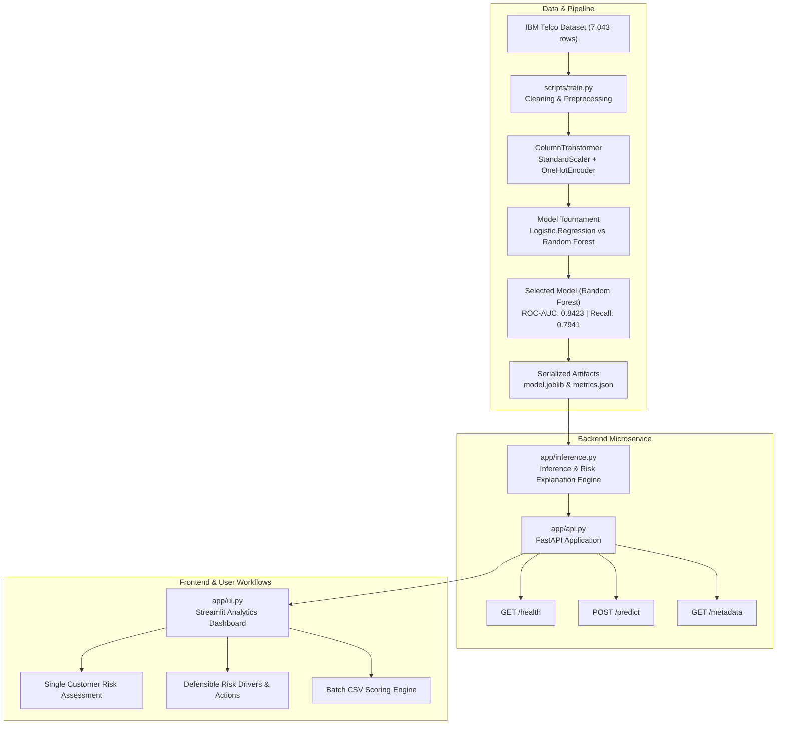

# 📡 Telecom Customer Churn Intelligence System

[](https://www.python.org/)
[](https://fastapi.tiangolo.com)
[](https://streamlit.io)
[](https://scikit-learn.org)
[](https://docs.pytest.org)
[](https://www.docker.com)

An end-to-end, production-grade Machine Learning system designed to predict telecommunications customer attrition, stratify customer risk tiers, generate defensible explanations of churn drivers, and provide targeted retention recommendations.

---

## 🏛️ System Architecture



---

## 📊 Dataset Profile

The model is trained on the official **IBM Telco Customer Churn** dataset:
- **Total Records:** 7,043 customers
- **Total Features:** 20 customer attributes + 1 binary target (`Churn`)
- **Churn Rate:** ~26.5% positive churn class (4:1 class imbalance)
- **Key Feature Categories:**
  - *Demographics:* Gender, Senior Citizen, Partner, Dependents
  - *Subscribed Services:* Phone Service, Multiple Lines, Internet Service (DSL / Fiber optic / None), Online Security, Online Backup, Device Protection, Tech Support, Streaming TV, Streaming Movies
  - *Account & Contract:* Tenure (0–72 months), Contract Type (Month-to-month, One year, Two year), Paperless Billing, Payment Method (Electronic check, Mailed check, Bank transfer auto, Credit card auto), Monthly Charges, Total Charges

---

## 🏆 Model Benchmarks & Empirical Results

The pipeline evaluates multiple algorithmic candidates on a **held-out test set (20% stratified split)**. Because missing a churning customer costs 5–10x more than an unnecessary retention discount, **Recall (Sensitivity)** and **ROC-AUC** are prioritized alongside F1-score:

| Model Candidate | Accuracy | Precision | Recall (Sensitivity) | F1-Score | ROC-AUC | Status |
| :--- | :---: | :---: | :---: | :---: | :---: | :---: |
| **Random Forest (Tuned)** | **0.7488** | **0.5174** | **0.7941** | **0.6266** | **0.8423** | 🏆 **Selected** |
| **Logistic Regression** | 0.7381 | 0.5043 | 0.7834 | 0.6136 | 0.8415 | Baseline |

### Test Set Confusion Matrix (Random Forest, $N = 1,409$)
- **True Negatives (Correctly identified as Retained):** 758
- **False Positives (Retained flagged as At-Risk):** 277
- **False Negatives (Missed churners):** 77
- **True Positives (Correctly flagged churners):** 297

*(Visual confusion matrix, ROC curve, and feature importance bar plots are saved in `model/`).*

---

## ⚖️ Ethical AI: Probability Over Certainty

> **Core Governance Policy:** Predictions in this system are strictly probabilistic risk estimates derived from historical patterns. They are **never presented as certainties or deterministic fates**.

Every API response and frontend dashboard screen prominently includes the statistical disclaimer:
```json
"disclaimer": "Never present predictions as certainties: Predictions represent probabilistic estimates based on historical statistical patterns, not guaranteed individual outcomes."
```

Customers are categorized into three defensible tiers:
1. **Low Risk (< 35% probability):** Retained, loyal customer profile; suitable for relationship nurturing or upsell.
2. **Medium Risk (35% – 65% probability):** Vulnerable customer profile with early friction indicators; candidate for targeted engagement.
3. **High Risk (> 65% probability):** Critical attrition exposure; immediate priority for retention offers and customer success intervention.

---

## 📂 Repository File Tree

```
Persevex-AI-Deployment/
├── app/
│   ├── __init__.py           # Application package definition
│   ├── api.py                # FastAPI microservice with /health and /predict
│   ├── inference.py          # Inference engine, risk scoring & driver explanations
│   ├── schemas.py            # Pydantic input/output schemas with validation
│   └── ui.py                 # Streamlit analytical dashboard
├── data/
│   └── WA_Fn-UseC_-Telco-Customer-Churn.csv  # IBM Telco dataset (7,043 rows)
├── model/
│   ├── model.joblib          # Trained best pipeline (Preprocessor + Classifier)
│   ├── preprocessor.joblib   # Fitted ColumnTransformer object
│   ├── classifier.joblib     # Fitted Random Forest estimator
│   ├── metrics.json          # Benchmark evaluation metrics & scores
│   ├── feature_names.json    # Transformed feature name registry
│   ├── feature_importance.json # Sorted global feature importances
│   ├── confusion_matrix.png  # Confusion matrix visualization
│   ├── roc_curve.png         # ROC curve comparison plot
│   └── feature_importance.png# Top 10 feature importance plot
├── scripts/
│   ├── download_data.py      # Dataset acquisition with mirror fallback
│   ├── train.py              # Reproducible training & evaluation pipeline
│   └── evaluate.py           # Independent validation script
├── tests/
│   ├── __init__.py
│   ├── test_data.py          # Data validation & cleaning tests
│   ├── test_model.py         # Serialization & inference sanity tests
│   └── test_api.py           # FastAPI endpoint & validation tests
├── Dockerfile                # Production multi-service container definition
├── docker-compose.yml        # Docker Compose configuration
├── entrypoint.sh             # Container orchestration entrypoint
├── requirements.txt          # Python dependencies
├── .dockerignore             # Docker build exclusion rules
├── .gitignore                # Git repository exclusion rules
├── README.md                 # Complete system documentation
├── REPORT.md                 # Formal project report & methodology
├── PRESENTATION.md           # 10-slide executive presentation outline
├── DEMO_CHECKLIST.md         # Video demonstration protocol
└── submission/               # Bundled submission package & LINKS.txt
```

---

## 🚀 Quickstart Guide

### 1. Environment Setup
```bash
# Clone or navigate to the repository
cd Persevex-AI-Deployment

# Create and activate virtual environment
python -m venv .venv

# On Windows:
.\.venv\Scripts\activate

# On Linux / macOS:
source .venv/bin/activate

# Install required dependencies
pip install -r requirements.txt
```

### 2. Dataset Acquisition & Training Pipeline
```bash
# Verify or download dataset
python scripts/download_data.py

# Execute complete training, evaluation, and artifact generation
python scripts/train.py

# (Optional) Run independent model evaluation
python -m scripts.evaluate
```

### 3. Run Automated Tests
```bash
pytest -v
```
*All 11 automated unit and integration tests will execute and pass in ~10 seconds.*

### 4. Launch Services

#### Terminal 1 — FastAPI Backend (Port 8000)
```bash
uvicorn app.api:app --host 127.0.0.1 --port 8000 --reload
```
- Interactive Swagger UI: `http://127.0.0.1:8000/docs`
- Redoc UI: `http://127.0.0.1:8000/redoc`
- Health check: `http://127.0.0.1:8000/health`

#### Terminal 2 — Streamlit Frontend (Port 8501)
```bash
streamlit run app/ui.py
```
- Dashboard URL: `http://localhost:8501`

---

## 🐳 Docker Deployment

The project contains a containerization setup configured to run both the FastAPI microservice and Streamlit frontend in a single container.

### Option A: Using Docker Directly
```bash
# 1. Build the container image
docker build -t telecom-churn:latest .

# 2. Run container (FastAPI on 8000, Streamlit on 8501)
docker run -d -p 8000:8000 -p 8501:8501 --name telecom_churn_app telecom-churn:latest

# 3. Check container logs
docker logs -f telecom_churn_app

# 4. Stop container
docker stop telecom_churn_app
```

### Option B: Using Docker Compose
```bash
# Build and launch with one command
docker-compose up -d --build

# View logs
docker-compose logs -f

# Shutdown
docker-compose down
```

---

## 🔌 API Reference

### 1. `GET /health`
Verifies backend operational status, model availability, and loaded feature dimensionality.

**Response Example:**
```json
{
  "status": "healthy",
  "model_loaded": true,
  "model_name": "RandomForest",
  "model_version": "1.0.0",
  "features_count": 46
}
```

### 2. `POST /predict`
Evaluates a single customer record with full Pydantic validation.

**Request Payload:**
```json
{
  "gender": "Female",
  "SeniorCitizen": 0,
  "Partner": "No",
  "Dependents": "No",
  "tenure": 2,
  "PhoneService": "Yes",
  "MultipleLines": "No",
  "InternetService": "Fiber optic",
  "OnlineSecurity": "No",
  "OnlineBackup": "No",
  "DeviceProtection": "No",
  "TechSupport": "No",
  "StreamingTV": "Yes",
  "StreamingMovies": "No",
  "Contract": "Month-to-month",
  "PaperlessBilling": "Yes",
  "PaymentMethod": "Electronic check",
  "MonthlyCharges": 85.50
}
```

**Response Payload:**
```json
{
  "churn_prediction": 1,
  "churn_probability": 0.8611,
  "churn_percentage": "86.1%",
  "risk_category": "High Risk",
  "disclaimer": "Never present predictions as certainties: Predictions represent probabilistic estimates based on historical statistical patterns, not guaranteed individual outcomes.",
  "key_risk_factors": [
    {
      "feature": "Contract: Month-to-month",
      "impact": "Increases Churn Risk",
      "description": "Flexible rolling contract provides zero barrier to switching carriers; historically the strongest statistical driver of churn."
    },
    {
      "feature": "Tenure: 2 months (Early Lifecycle)",
      "impact": "Increases Churn Risk",
      "description": "Customers within their first 6 months have historically the highest attrition rates before loyalty stabilizes."
    },
    {
      "feature": "Internet: Fiber Optic without TechSupport",
      "impact": "Increases Churn Risk",
      "description": "High-bandwidth Fiber optic accounts without dedicated tech support exhibit heightened frustration-driven churn."
    }
  ],
  "recommended_retention_actions": [
    "Propose 1-year contract renewal with a 15% promotional discount or bundle credit.",
    "Incentivize enrollment in automatic bank/credit card payments with a $5 recurring bill credit.",
    "Offer 3 months of complimentary VIP Tech Support and Security Suite upgrade."
  ]
}
```

---

## 👥 Authors & License
- **Project:** Telecom Customer Churn Prediction Deployment
- **Architecture:** Scikit-Learn | FastAPI | Streamlit | Docker
- **License:** MIT License
